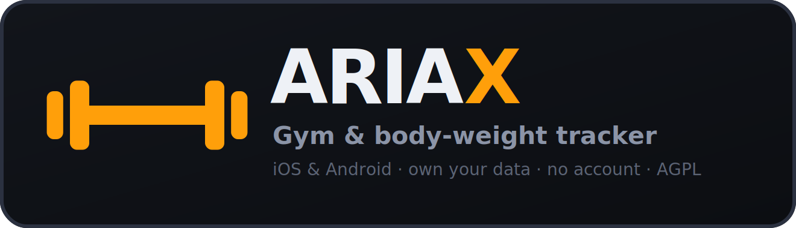

**A gym & body-weight tracker for iPhone and Android. No account, no server, no ads.**

ARIAX is a personal fork of [openGym-fa](https://github.com/Jenesyx/opengym-fa), set up around the
mobile flavour: the app runs entirely on the phone, your training data stays in the app's private
storage, and nothing is sent anywhere. Persian and English interface (plus 11 more languages),
1,324 exercises with animated demos, automatic progression, estimated 1RM, activity heatmap and
muscle map.

**English** · [فارسی](README.fa.md)

### Added in this fork

**Pre-workout warm-up** — a fixed 3-minute round of six moderate moves (Jumping Jacks, Jump
Squat, Butt Kicks, Burpee, Pop Squat, Shuffle), 20 s each with 10 s between them and a 10 s
lead-in. Reachable from the home screen and from the start-workout screen. Countdown ring, audio
and haptic cues on every transition, pause and skip, and the screen stays awake while it runs.
Nothing is logged — it is preparation, not a session.

---

## Before your first build

Two values in this repository are placeholders — change them now, not later:

| Where | What | Note |
|---|---|---|
| `package.json` | `YOUR-GITHUB-USERNAME` in `repository`, `homepage`, `bugs` | cosmetic |
| everywhere | app id `app.ariax.gym` | **cannot change after the first install** — Android refuses to update an app whose id changed |

To use a different app id, replace it in `frontend/capacitor.config.json`,
`frontend/android/app/build.gradle`, `frontend/android/app/src/main/res/values/strings.xml`,
`frontend/ios/App/App.xcodeproj/project.pbxproj`, and rename the Java package folder
`frontend/android/app/src/main/java/app/ariax/gym/` (and the `package` line inside
`MainActivity.java`) to match.

## Build the app

```sh
cd frontend
npm install
npm run build:mobile     # web build + cap sync into android/ and ios/
```

Re-run `build:mobile` after every change to the web code, before building natively.

### Android

Needs Android Studio (for the SDK) and Java 21.

```sh
npx cap open android                    # then Run on a device or emulator
```

For an installable APK:

```sh
cd android && ./gradlew assembleRelease

# one-time — KEEP this keystore, updates must be signed with the same key
keytool -genkeypair -keystore ariax.keystore -alias ariax -keyalg RSA -validity 10950

zipalign -f -p 4 app/build/outputs/apk/release/app-release-unsigned.apk aligned.apk
apksigner sign --ks ariax.keystore --ks-key-alias ariax --out ARIAX.apk aligned.apk
```

### iPhone

Needs a Mac with Xcode 15+ and CocoaPods (`brew install cocoapods`).

```sh
npx cap open ios          # Xcode -> Signing & Capabilities -> your Apple ID team -> Run
```

A free Apple ID installs the app on your own iPhone, but the signature expires after 7 days, so you
re-run it from Xcode weekly. A paid developer account extends that to a year. There is no App Store
build — Apple's store terms and the AGPL don't mix well, and this is a personal app.

## Icon & branding

`frontend/resources/icon.svg` (1024x1024) is the single source for the app icon. After editing it:

```sh
cd frontend
npx @capacitor/assets generate --iconBackgroundColor '#0c0e12' --splashBackgroundColor '#0c0e12'
```

That regenerates every Android mipmap, the iOS asset catalogue and the splash screens. The PWA
icons in `frontend/public/` (`icon-180.png`, `icon-512.png`) are exported from the same file. The
default accent colour is set in `frontend/src/store/useStore.js`; all eight accents remain
selectable in Settings.

## Your data

The mobile app keeps everything in `ariax-state.json` in the app's private directory — invisible to
other apps, removed when the app is uninstalled. **Export a backup from Settings → Data now and
then**; it goes out through the OS share sheet, so you can drop it into Files, Telegram or email.

## Web / self-hosted flavour

The same codebase still runs as a self-hosted web app with passkey sign-in and multi-device sync
(`docker compose up -d --build`). See [docs/README.upstream.md](docs/README.upstream.md) for the
original project's full documentation, and [docs/SELF_HOSTING.md](docs/SELF_HOSTING.md).

## Credits & licence

ARIAX is a fork — the underlying work is not mine. Original openGym by **Duarte Santos**; the
Persian edition openGym-fa by **[Arta (Jenesyx)](https://github.com/Jenesyx)**. This fork changes
naming, icons and colour.

[GNU AGPL v3.0](LICENSE) — you may use, modify and share it; if you run a modified version as a
network service, its source must be offered under the same licence. Exercise images/GIFs come from
the upstream dataset and keep their own terms, see [NOTICE.md](NOTICE.md).
